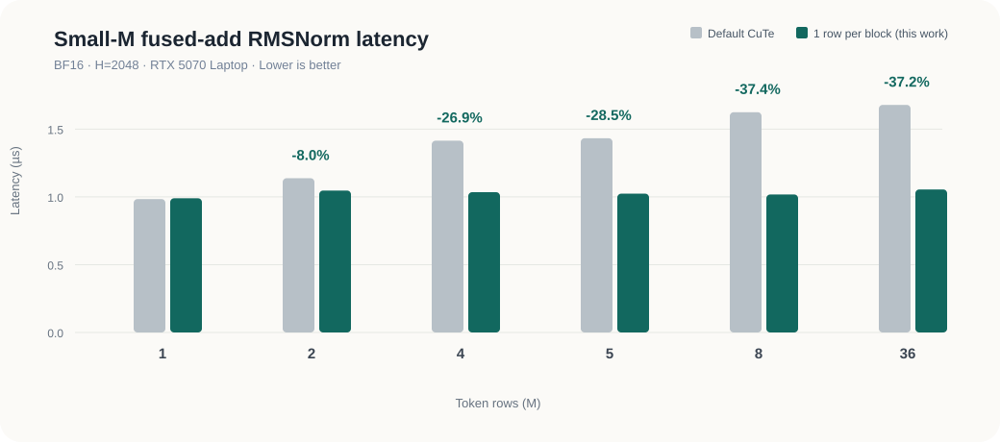

# One Row per Block: Up to 1.60x Faster Fused RMSNorm on an RTX 5070 Laptop

**A small CUDA block-mapping change, measured from one kernel to a real SGLang model**  
Ravi Kothari · October 21, 2026 · RTX 5070 Laptop (SM120) · BF16 · H=2048

**Live article:** [ravi-kot.github.io/flashinfer-small-m-rmsnorm](https://ravi-kot.github.io/flashinfer-small-m-rmsnorm/)

| Best isolated result | Best in-model norm result | Correctness |
| :--- | :--- | :--- |
| **1.60x speedup** at M=8 | **1.25x critical-path ratio** at batch 8, guarded dispatch | **117/117** kernel cases matched, plus an extended M, H and dtype matrix |

> **Summary:** In the tested SGLang 0.5.21 environment, FlashInfer 0.6.18's default CuTe kernel puts four token rows in one CUDA block for this shape. At small M, this gives the GPU very few blocks to schedule. Changing the mapping to one row per block lowered isolated kernel latency by **26.86% to 37.35% at M=4 to 36**. An expanded sweep led to a guarded dispatch range of **4 ≤ M ≤ 64**. Inside Qwen3.5-2B, that rule reduced normalization critical-path time by **12% to 20% at batch 4 to 32**, while batches 1 and 2 continued to use the installed FlashInfer 0.6.18 kernel. Saved model outputs matched bit for bit.



## 1. The question

I started this work after reading Coral Bricks' [Qwen3.6 H100 latency study](https://www.coralbricks.ai/blog/ai-latency-engineering) and its [experiment archive](https://github.com/Coral-Bricks-AI/reef/tree/33aefaa12d78891bf5ba70a0d96b070d471ecc78/research/qwen36-h100).

Their work follows a useful rule: measure the shapes that the model really runs. A kernel that is good for a large batch can waste most of the GPU at a small batch.

That made me interested in how individual GPU kernels perform during small-batch inference. I wondered whether the RMSNorm kernel was already optimized for workloads with only a few token rows.

While tracing SGLang's inference path, I found that its fused-add Gemma RMSNorm operation uses FlashInfer's CuTe implementation. The kernel processes four token rows in one 128-thread CUDA block. For a small workload, that produces only one or two blocks and gives the GPU little independent work to schedule.

I tested whether changing the mapping to one row per CUDA block could expose more parallelism across SMs. I first measured the kernel by itself, then integrated the modification into SGLang's Qwen3.5-2B decode path.

Coral Bricks measured Qwen3.6-35B-A3B-FP8 on an H100. I used the resources available locally: Qwen3.5-2B in BF16 on an RTX 5070 Laptop GPU (SM120), with hidden size 2048. This is a smaller-scale follow-up rather than a direct H100 comparison. Within this setup, the change produced a repeatable improvement over the installed FlashInfer kernel.

## 2. Finding the kernel that really runs

In SGLang 0.5.21, the model calls `gemma_fused_add_rmsnorm`. On this machine, that call reaches FlashInfer 0.6.18's CuTe DSL `FusedAddRMSNormKernel`.

The operator performs two jobs:

1. Add the residual to the input.
2. Apply Gemma-style RMSNorm.

I checked the runtime path and recorded the kernel name and launch shape. PDL was enabled, and the model launched one fused kernel per call.

> **Configuration change:** I kept the hidden size and normalization arithmetic fixed, but changed the launch from four rows in one 128-thread block to one row in each 32-thread block. The grid therefore grows from `ceil(M / 4)` blocks to `M` blocks.

At hidden size 2048, the two configurations are:

| Launch property | Default CuTe | Modified mapping |
| :--- | ---: | ---: |
| Threads per block | 128 | 32 |
| Warps per block | 4 | 1 |
| Rows per block | 4 | 1 |
| Blocks at M=4 | 1 | 4 |
| Blocks at M=8 | 2 | 8 |

A CUDA block runs on one SM. The four warps in the default M=4 block can run together, but all four remain on one SM. The modified mapping gives the scheduler four independent blocks and makes more SMs available for the work.

## 3. The change

The experiment changes the block mapping; the normalisation math remains the same.

```diff
- self.num_threads = RMSNormKernel._compute_num_threads(self.H_per_cta)
+ self.num_threads = self.threads_per_row
```

I made the matching change to the shared-memory estimate so that the estimate and launch agree. The two-line experimental kernel patch is available in [`one_row_per_cta.diff`](patch/one_row_per_cta.diff). The guarded model experiment used the router described in Section 6 rather than applying this candidate at every M.

This mapping has a cost. It launches more blocks and reads the weight vector once per row. The kernel dispatcher, or router, should select it for small row counts where extra grid parallelism pays for that work. On this GPU, the evidence supports the range `4 <= M <= 64`; the following section shows how I measured those boundaries.

## 4. Isolated kernel results

The benchmark used BF16 inputs, hidden size 2048, CUDA Graph replay, and L2-warm data. Each small-M result contains 60 paired measurements from three processes. An unchanged local copy served as an A/A control and stayed within about 0.01 microseconds of the installed kernel for M up to 36.

Latency reduction is `(default - modified) / default x 100`. Lower latency is better.

| Token rows (M) | Default CuTe | Modified | Latency reduction | Description |
| ---: | ---: | ---: | ---: | :--- |
| 1 | 0.984 µs | 0.990 µs | -0.61% | Almost identical |
| 2 | 1.138 µs | 1.047 µs | 8.00% | Improvement |
| 4 | 1.415 µs | 1.035 µs | **26.86%** | **Improvement** |
| 5 | 1.433 µs | 1.024 µs | **28.54%** | **Improvement** |
| 8 | 1.625 µs | 1.018 µs | **37.35%** | **Improvement** |
| 36 | 1.679 µs | 1.055 µs | **37.16%** | **Improvement** |
| 2304 | 14.740 µs | 14.800 µs | -0.41% | Almost identical |

At M=8, latency fell from 1.625 microseconds to 1.018 microseconds. That is a **1.60x speedup**. At M=2304, the small difference is comparable to the experiment's noise and does not establish a gain or meaningful loss.

The saving also remained in a dependent producer, norm, and consumer chain. This control matters because an isolated warm-cache kernel can hide costs that appear when the operation is surrounded by real work.

### Boundary and sensitivity

A later sweep repeated the method with three new rounds at H=2048 and two rounds for each other configuration. Values are the paired difference, one-row minus the unchanged copy, in microseconds. Bold marks a 95% confidence interval that excludes zero.

| Configuration | M=1 | M=4 | M=8 | M=36 | M=64 | M=96 | M=144 |
| :--- | ---: | ---: | ---: | ---: | ---: | ---: | ---: |
| H=2048 BF16 | -0.015 | **-0.398** | **-0.610** | **-0.635** | **-0.428** | **-0.159** | -0.018 (tie) |
| H=1024 BF16 | +0.003 | **-0.180** | **-0.283** | **-0.231** | **-0.152** | – | -0.017 (tie) |
| H=2560 BF16 | +0.024 | **-0.490** | **-0.793** | **-0.765** | **-0.561** | – | +0.001 (tie) |
| H=4096 BF16 | -0.014 | **-0.441** | **-0.428** | **-0.383** | **-0.157** | – | +0.035 (tie) |
| H=2048 FP16 | -0.003 | **-0.391** | **-0.606** | **-0.622** | **-0.423** | – | +0.034 (tie) |

The most useful result beyond the 1.60x peak is consistency: M=4 through M=64 improved in every tested hidden-size and dtype configuration, and every corresponding confidence interval excluded zero.

At H=2048 the one-row kernel was faster at every tested M from 2 to 96 and tied at 144 and 2304. The M=576 measurement moved in the favorable direction, but its A/A control moved as well, so it is excluded from the dispatch decision. At H=4096 the modified mapping launches 64-thread blocks, two warps per row, and the gain held through M=64.

The expanded raw results and launch records are in [`data/kernel/validation/`](data/kernel/validation/).

### Why the dispatch starts at M=4

I crossed PDL on and off, CUDA Graph and eager execution, and warm and cold L2 conditions at M=1, 2, 4, and 8. The table below shows the CUDA Graph critical-path difference, one-row minus unchanged copy. Negative is faster.

| Condition | M=1 | M=2 | M=4 | M=8 |
| :--- | ---: | ---: | ---: | ---: |
| Warm L2, PDL on | +0.03 µs | -0.16 µs | **-0.59 µs** | **-0.62 µs** |
| Cold L2, PDL on | +0.40 µs | +0.05 µs | **-0.34 µs** | **-1.08 µs** |
| Warm L2, PDL off | +0.10 µs | -0.07 µs | **-0.40 µs** | **-0.56 µs** |
| Cold L2, PDL off | +0.56 µs | +0.77 µs | **-0.25 µs** | **-0.28 µs** |

M=1 gained no additional grid parallelism and regressed with cold data. M=2 depended on cache and PDL state. M=4 and M=8 improved in every captured condition. Turning PDL off did not remove the M=1 cold-data penalty, so dependency-wait accounting is not its sole cause. Eager critical-path measurements contained large CPU launch gaps; the captured results match the model's CUDA Graph execution more closely. This evidence supports using the installed kernel below M=4.

### What the profiler showed

Nsight Compute compared the unchanged local CuTe copy with the one-row candidate and showed the expected launch geometry:

| Measurement | Unchanged CuTe copy | Modified |
| :--- | ---: | ---: |
| Blocks launched at M=4 | 1 | 4 |
| Blocks launched at M=8 | 2 | 8 |
| Effective active-SM equivalents at M=4 | 1.00 | 3.98 |
| Effective active-SM equivalents at M=8 | 2.00 | 7.91 |
| Busiest-SM active cycles at M=4 | 3,210 | 2,096 |
| Busiest-SM active cycles at M=8 | 3,650 | 2,130 |
| Long-scoreboard stalls per issued instruction at M=4 | 1.31 | 0.72 |
| Long-scoreboard stalls per issued instruction at M=8 | 1.37 | 0.73 |

The “effective active-SM equivalents” estimate is `36 x sm__cycles_active.avg / sm__cycles_active.max`. NVIDIA documents `.avg` and `.max` as rollups across hardware-unit instances in the [Nsight Compute Profiling Guide](https://docs.nvidia.com/nsight-compute/ProfilingGuide/). This is a useful activity estimate, not an exact count of physical SMs. The grid size gives the direct scheduling bound: one block can use at most one SM, while four independent blocks can be scheduled across more SMs.

In this Nsight Compute capture, the reported register count was 124 per thread for both kernels. The one-row mapping reduced the profiler's theoretical occupancy figure from 25.0% to 20.8%, yet it exposed enough independent blocks to use more SMs. At M=8, measured L2 traffic rose from 142.8 KB to 168.4 KB because each block reread the weight vector, while busiest-SM cycles fell by 42% and long-scoreboard stalls nearly halved. The result is a useful tradeoff: more traffic and lower per-block occupancy, but a shorter critical path because the rows are no longer concentrated on two SMs.

These results support **insufficient grid-level parallelism** as the opportunity. They do not prove that DRAM bandwidth or a particular cache level was the bottleneck.

## 5. Correctness

The modified kernel was checked on 117 cases covering:

- Several random seeds.
- Zeros, cancellation, large values, and tiny values.
- Residual-heavy inputs and wide weights.
- Different row scales to expose accidental mixing between rows.
- Guard rows to catch out-of-range writes.

The modified output matched the installed and unchanged-copy outputs bit for bit in all 117 cases. Saved tokens and final logits also matched in the original eight-run model test and in all 16 guarded runs.

The expanded checks added M = 64, 65, 96, 144, 576 and 2304, hidden sizes 1024, 2560 and 4096, and FP16. Every tested case was again bitwise identical.

This establishes equivalence to the tested implementation for these cases. It does not claim exact agreement with every higher-precision mathematical reference.

The original output is saved in the [`117-case correctness log`](data/kernel/rowmap_check_20261020T064710Z.txt). The [`expanded run log`](data/kernel/validation/stages_20261021T220557Z.log) records the later correctness and launch-geometry checks.

## 6. Testing inside a real model

I used [`Qwen/Qwen3.5-2B`](https://huggingface.co/Qwen/Qwen3.5-2B). It has hidden size 2048 and uses the fused-add Gemma-style normalization path studied here.

The final model experiment used a guarded router: one row per block for `4 <= M <= 64`, and the installed kernel everywhere else. SGLang decoded with CUDA Graphs at batches 1, 2, 4, 8, 16, and 32. Each arm ran four alternating rounds with 300 timed decode steps per batch. A separate three-step CUPTI trace in every round verified the kernel inside the graph.

Each decode step contained 48 fused-add normalization calls. The table reports their total **critical-path time**: each norm's end minus the previous kernel's end. This removes time that a PDL-launched kernel spends waiting for its predecessor. It agreed with summed CUPTI duration to within 0.3 microseconds per step.

| Decode batch | Default norm time | Guarded dispatch | Latency reduction | Kernel selected |
| ---: | ---: | ---: | ---: | :--- |
| 1 | 67.7 µs | 66.9 µs | - | Installed fallback |
| 2 | 85.6 µs | 84.9 µs | - | Installed fallback |
| 4 | 101.4 µs | 89.4 µs | **11.9%** | **One row/block** |
| 8 | 109.3 µs | 87.4 µs | **20.0%** | **One row/block** |
| 16 | 133.9 µs | 110.9 µs | **17.2%** | **One row/block** |
| 32 | 145.0 µs | 122.3 µs | **15.7%** | **One row/block** |

I verified the dispatch from the kernels captured inside each decode graph. Batches 1 and 2 replayed the installed 128-thread kernel. Batches 4 to 32 replayed the one-row implementation with grid `(B, 1, 1)` and 32 threads per block. This confirms that graph capture preserved both the optimized route and the fallback selected by the router.

Saved greedy tokens and final logits matched bit for bit across all 16 guarded runs. The raw model CSVs and metadata are in [`data/model/guarded/`](data/model/guarded/); hashes identify the omitted tensor files.

This is the normalization portion of a transformer step. Attention, projections, Gated DeltaNet state updates, and runtime scheduling remain outside this measurement.

## 7. Reproduce the experiment

The supporting files are included with this article and in the [GitHub repository](https://github.com/ravi-kot/flashinfer-small-m-rmsnorm):

| Path | Purpose |
| :--- | :--- |
| [`repro/validation/rowmap.py`](repro/validation/rowmap.py) | Exact correctness, timing, diagnosis, and profiling driver used for the final sweep |
| [`repro/validation/local_cute/fused_add_rmsnorm_1row.py`](repro/validation/local_cute/fused_add_rmsnorm_1row.py) | Modified CuTe kernel; the unchanged comparison copy is beside it |
| [`repro/validation/model_bench.py`](repro/validation/model_bench.py) | Guarded Qwen3.5-2B model A/B runner |
| [`repro/validation/onerow_patch.py`](repro/validation/onerow_patch.py) | Runtime router used to test the guarded dispatch without modifying installed packages |
| [`data/README.md`](data/README.md) | Guide to raw measurements, metadata, profiler metrics, and artifact hashes |
| [`patch/one_row_per_cta.diff`](patch/one_row_per_cta.diff) | Unguarded experimental kernel patch used to construct the candidate |

The expanded run log, with machine-local paths removed, is included beside the validation CSVs. The repository ignores generated tensors, Python caches, and scratch result folders.

## 8. Full-step timing as an integration check

The normalization saving is small compared with the complete decode step. The selected kernels saved about 12 to 23 microseconds across 48 norm calls, while a full step lasted about 12 to 17 milliseconds.

| Decode batch | Default full step | Guarded full step | Observed difference |
| ---: | ---: | ---: | ---: |
| 1 | 12.329 ms | 12.429 ms | +0.100 ms |
| 2 | 12.210 ms | 12.118 ms | -0.092 ms |
| 4 | 12.409 ms | 12.357 ms | -0.052 ms |
| 8 | 12.889 ms | 12.896 ms | +0.007 ms |
| 16 | 13.909 ms | 13.798 ms | -0.111 ms |
| 32 | 16.893 ms | 16.866 ms | -0.027 ms |

These are medians of four round medians. The per-round differences varied by roughly 20 to 320 microseconds and moved in both directions. Batches 1 and 2 used the same installed kernel in both arms yet still moved by about 100 microseconds, which gives a practical noise reference for this laptop measurement.

The full-step data therefore serves as an integration check: model outputs stayed identical, execution remained stable, and the norm saving remained visible in the component trace. This experiment is not precise enough to attribute a request-level latency change of only a few tens of microseconds. Throughput, TTFT, and TPOT require a serving benchmark with controlled concurrency and a larger workload.

## 9. Future experiments

| No. | Experiment | Next measurement |
| ---: | :--- | :--- |
| 1 | Guarded RMSNorm on H100 | Repeat the paired kernel matrix and model trace on the target architecture, then test production serving traffic. |
| 2 | Gated DeltaNet state update and causal Conv1D | Profile the decode critical path, then test block mapping, vectorization, and avoidable memory traffic. |
| 3 | RMSNorm plus downstream fusion | Fuse normalization with a real consumer and measure whether removing the intermediate write produces a larger step-level saving. |
| 4 | Small-batch GEMV | Identify decode projections that remain memory or launch bound and compare tuned CUDA or Triton kernels with the current backend. |

### References

- [Coral Bricks: AI latency engineering, 50% faster decoding on H100](https://www.coralbricks.ai/blog/ai-latency-engineering)
- [Coral Bricks: Qwen3.6 H100 experiment archive](https://github.com/Coral-Bricks-AI/reef/tree/33aefaa12d78891bf5ba70a0d96b070d471ecc78/research/qwen36-h100)
- [FlashInfer 0.6.18 fused-add RMSNorm implementation](https://github.com/flashinfer-ai/flashinfer/blob/v0.6.18/flashinfer/norm/kernels/fused_add_rmsnorm.py)

---

*Tested environment: NVIDIA RTX 5070 Laptop GPU, SM120, 36 SMs, 8 GB VRAM; SGLang 0.5.21; FlashInfer 0.6.18; PyTorch 2.13.0+cu130; WSL2 Ubuntu 24.04.*

## 10. Findings and limits

This experiment shows that a one-row-per-block mapping reduced a small-grid parallelism limit for the tested fused-add RMSNorm shapes. It reached **1.60x isolated speedup at M=8** and reduced Qwen3.5-2B normalization critical-path time by **12% to 20% at batch 4 to 32** with a guarded `4 <= M <= 64` dispatch. The installed kernel remains the fallback outside that range.

More broadly, the result shows that small-M RMSNorm workloads can still contain useful, shape-specific optimization opportunities when the default launch exposes too little parallel work.

The implementation matched all **117 original kernel cases**, the expanded M, hidden-size, and dtype checks, and all saved model tokens and logits.

### What this work does not establish

- An H100 result.
- A Qwen3.6-35B result.
- A production MTP result.
- A request-level throughput, TTFT, or TPOT improvement.
- A dispatch range for GPU architectures beyond SM120.
